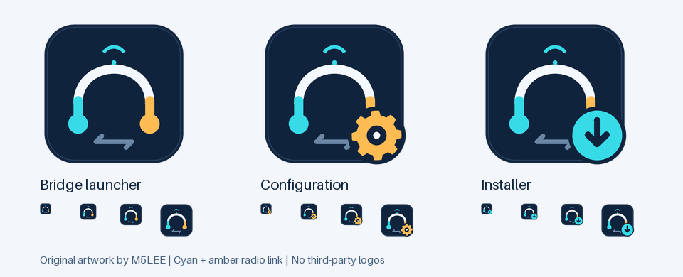

# WiresX 2 YSF Bridge

**By M5LEE · 0.1.0-alpha.9 · Free, experimental Windows software**

Connect the room currently linked in **official WIRES-X** to a **YSF reflector**. WiresX 2 YSF Bridge carries digital voice and supported caller information between the two networks, using your existing WIRES-X installation and genuine HRI-200.

**Set up WIRES-X first.** The bridge uses its existing account configuration and follows its currently connected room. Normal bridge configuration asks for just your **YSF bridge callsign** and **YSF destination room**—there is no second WIRES-X account setup.

## Downloads

| File | Download |
|---|---|
| Windows x64 installer | [Setup.exe](https://github.com/M5LEE/wiresx-2-ysf-bridge/releases/download/v0.1.0-alpha.9/WiresX-2-YSF-Bridge-0.1.0-alpha.9-Setup.exe) |
| Alpha.9 source snapshot | [Source.zip](https://github.com/M5LEE/wiresx-2-ysf-bridge/releases/download/v0.1.0-alpha.9/WiresX-2-YSF-Bridge-0.1.0-alpha.9-Source.zip) |
| File checksums | [SHA256SUMS.txt](https://github.com/M5LEE/wiresx-2-ysf-bridge/releases/download/v0.1.0-alpha.9/WiresX-2-YSF-Bridge-0.1.0-alpha.9-SHA256SUMS.txt) |

[Release page](https://github.com/M5LEE/wiresx-2-ysf-bridge/releases/tag/v0.1.0-alpha.9) · [Release notes](docs/RELEASE-alpha.9.md)

Downloads currently require signing in to a GitHub account with access to this private repository.

## Features

- Links one WIRES-X room to one YSF destination at a time.
- Follows room changes made in WIRES-X.
- Searchable YSF room list and configurable DG-ID.
- Caller callsign and supported C4FM metadata forwarding.
- Windows launcher with room, connection and tray status.
- Optional automatic startup when you sign in to Windows.
- Automatic virtual-port setup using the bundled com0com dependency.

## Requirements

- Windows 10 or later, **64-bit**, with **.NET Framework 4.8**.
- Official **WIRES-X 2.0.1.0**, already configured and working, with the HRI-200 driver installed.
- A genuine **HRI-200** connected to the PC.
- An **FTM-100 for the initial local radio-profile capture**, unless you already have a compatible saved bridge profile.
- Administrator approval when requested. Use the same Windows account for setup, startup configuration and removal.

This is an independent project, not an official Yaesu product. WIRES-X software and Yaesu drivers are obtained separately.

## Installation and first-time setup

1. Download and run **`WiresX-2-YSF-Bridge-0.1.0-alpha.9-Setup.exe`** from the release page. Leave **Set up my bridge** selected on the final page.
2. Enter your **YSF bridge callsign** and select the **YSF destination room**. Check the destination's required DG-ID.
3. Enable **Advanced setup** and choose **Automatic setup**. After confirmation, setup detects the HRI-200 and configures the virtual-port connection. A compatible existing connection is reused.
4. If no valid radio profile is present, connect and power on your FTM-100, then choose **Create connection profile** under Advanced setup. The capture takes about two minutes, may close and reopen WIRES-X, and blocks PTT/voice during capture. Reopen Station setup afterwards to check the result.
5. **Power the FTM-100 off and leave the HRI-200 connected** for bridge operation. Save your settings, select **Open bridge**, then **Start bridge**. Allow several minutes for WIRES-X to log in and connect.

If setup already reports a valid connection and profile, reuse them; there is no need to repeat capture. **Import existing settings** under Advanced setup can import a compatible previous bridge folder while retaining your chosen YSF callsign.

## Everyday use

Choose or change the WIRES-X room in official WIRES-X as usual. Choose the YSF destination in the bridge settings. Saved bridge settings take effect on the next bridge start.

The launcher shows the current WIRES-X room, saved YSF destination and connection state. Use **Start bridge** and **Stop bridge** to control the link. It runs until stopped or a safety fault occurs; it does not stop on a normal session timer.

**Closing the window does not stop the bridge.** It hides to the Windows notification area. Double-click the tray icon to reopen it. **Exit status app (bridge stays running)** closes only the status application. A separate bridge session cannot be controlled from this launcher.

## Automatic startup

In the launcher, enable **Start bridge and WIRES-X automatically when I sign in to Windows**. At your next sign-in, the launcher starts the adapter before WIRES-X.

Startup is optional and initially off. Enabling it backs up and replaces matching WIRES-X/YMLAN Startup shortcuts so the programs start in the correct order; disabling it restores those shortcuts. Conflicting startup entries are reported for review.

This requires an interactive Windows sign-in. It is **not** a pre-login service and does not enable Windows automatic sign-in. Check startup on your own PC before relying on it unattended.

## Upgrading or uninstalling

Choose **Stop bridge**, wait for cleanup, then **Exit status app** and close any setup/settings windows before running an upgrade or uninstall. The installer refuses an active installation rather than stopping it for you. Do not run two copies of the bridge at once.

Normal uninstall retains your station settings and radio profile, shared virtual-port drivers and devices, and official WIRES-X. A valid existing profile can be reused after reinstalling. If you already run the alpha.9 callsign correction, an immediate reinstall is unnecessary.

## Alpha limitations

- The installer is **unsigned**, and the bridge remains experimental rather than a certified production system.
- The supported setup is limited to the WIRES-X version and hardware listed above. Other combinations are not confirmed compatible.
- The bundled legacy virtual-port driver may be blocked by Secure Boot or Memory Integrity. Setup checks device health and reports failures; do not disable Windows security to force it to load.
- Receiver compatibility, GPS accuracy, long-term reliability and fresh-PC setup are not fully validated. A connected indicator is not an audio-quality test.
- Do not rely on this bridge for emergency communications.

See [compatibility and testing](docs/VERIFICATION.md) for the current release's test coverage and limitations.

## Source and technical documentation

- [Building from source](docs/DEVELOPMENT.md)
- [C4FM metadata format](docs/C4FM-METADATA-PROFILES.md)
- [Third-party notices](THIRD_PARTY_NOTICES.md)

## Licence and optional support

Copyright (c) **2026 M5LEE**. Original contributions are under the [MIT licence](LICENSE), **AS IS and without warranty**. Bundled com0com remains separately GPL licensed; third-party rights remain with their owners. WIRES-X/HRI/Yaesu notices are in [THIRD_PARTY_NOTICES.md](THIRD_PARTY_NOTICES.md).

Donations to the **CumbriaCQ network** are entirely optional, not licence fees or feature unlocks:

- PayPal: https://www.paypal.com/donate?campaign_id=HQ9VSCMVLLYPC
- Support information: https://cumbriacq.com/donate-support/
